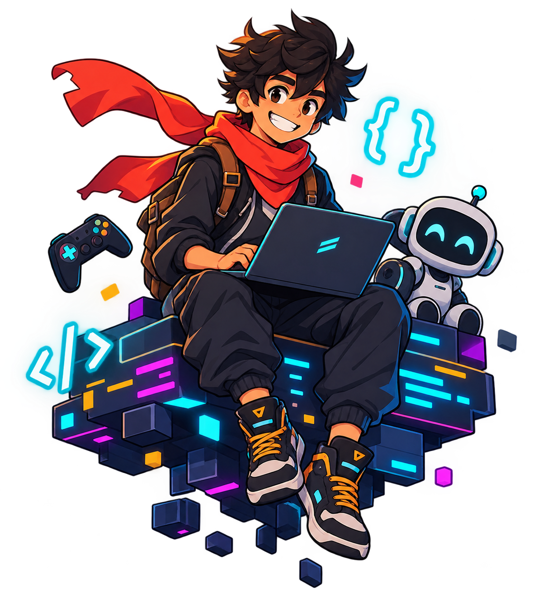

# Olá, eu sou o Rafael 👋

*Aprendendo e construindo, um projeto de cada vez.*

- 🎓 Estudante de **Sistemas de Informação** na UniCatólica, em Quixadá - CE
- 💡 Interesse em **desenvolvimento de software** e **inteligência artificial**
- 🛠️ Gosto de criar projetos e de ver como programação e IA podem resolver problemas
- 🎮 Fora do código: jogos e tecnologia
- 🎯 Objetivo: evoluir como desenvolvedor e ampliar meus conhecimentos

<table>
  <tr>
    <td valign="top" width="430">
      
       
      
    </td>
    <td align="center" valign="middle" width="260">
      <!-- MASCOTE (espaço reservado): envie assets/mascote.png (PNG com fundo transparente, altura próxima à dos dois cards, uns 290 px) e troque as duas linhas de comentário abaixo pela imagem. -->
      <!--  -->
    </td>
  </tr>
</table>

---

## 🛠️ Tecnologias

**Front-end** &nbsp;&nbsp;  &nbsp;  &nbsp; 

**Conhecimentos básicos** &nbsp;&nbsp;  &nbsp; 

---

## 🐍 Contribuições

  <picture>
    <source media="(prefers-color-scheme: dark)" srcset="https://raw.githubusercontent.com/RafaelPG1/RafaelPG1/output/github-contribution-grid-snake-dark.svg" />
    <source media="(prefers-color-scheme: light)" srcset="https://raw.githubusercontent.com/RafaelPG1/RafaelPG1/output/github-contribution-grid-snake.svg" />
    
  </picture>

